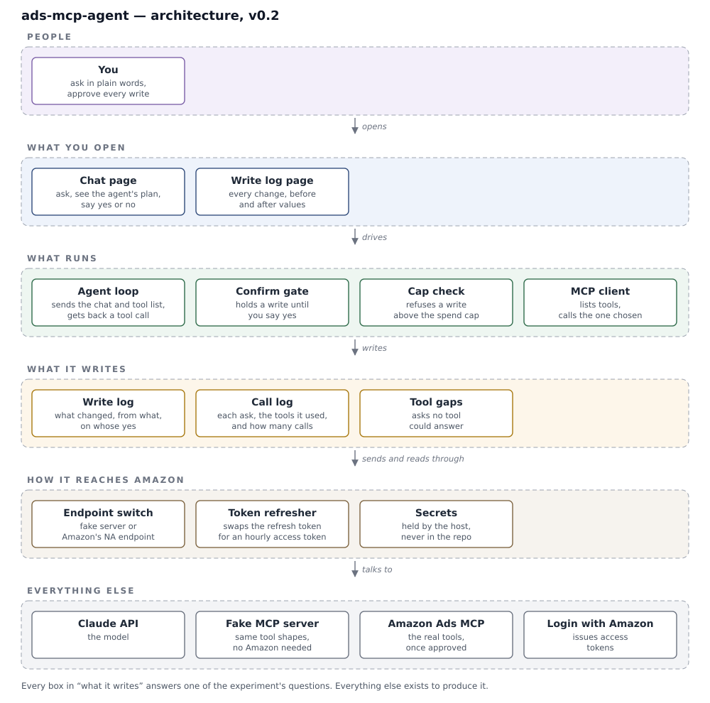

# ads-mcp-agent

**Purpose:** evaluate what an AI agent can reliably do against a live Amazon Ads account through Amazon's hosted MCP server, and record where it falls short, before any bespoke ads tooling is designed.

## Context

The Amazon Ads MCP server is an access layer over the existing Amazon Ads API, not a new capability. Each tool resolves to one or more Ads API requests, so rate limits, costs and account permissions are unchanged. The server is appropriate where a model selects operations at run time from a natural-language request. Deterministic, scheduled operations — dayparting, nightly reconciliation — remain on the direct API with no model in the path.

## Terms and definitions

| Term | Definition |
|---|---|
| **MCP server** | A service that publishes a catalogue of tools to an AI agent and executes each tool call as one or more API requests. Amazon hosts one for Amazon Ads at regional endpoints. |
| **Tool** | A single named operation exposed by an MCP server, such as retrieving campaign performance or updating a budget. |
| **MCP client** | The component that retrieves the tool catalogue from an MCP server and invokes tools on the agent's behalf. |
| **Profile** | An advertiser account in a single marketplace. Every Ads API request is scoped to one profile. |
| **Ads MCP simulator** | A local MCP server in this repository that implements the same tool contracts against fixture data, used until Amazon grants API access. |
| **Write** | Any tool call that changes account state: budget, bid, status or targeting. |
| **Spend cap** | The maximum budget value the application will permit any write to set. |
| **Flycast** | A Fly.io networking mode that assigns an application a private address only, with no public IP. |
| **WireGuard** | The VPN protocol Fly.io uses to admit client devices to an organisation's private network. |

## Evaluation objectives

| Question | Evidence |
|---|---|
| Which natural-language requests resolve to an available tool | Coverage gaps recorded per request |
| What one request costs in Ads API calls | Call counts in the invocation log |
| Whether Amazon previews a write before applying it | Behaviour of the first budget change |
| Whether a KDP author profile is accepted by the MCP server | Profile listing after API approval |
| Which requests depend on data Amazon does not expose | Requests involving organic sales, cannibalisation or product leadership |

## Architecture

| Layer | Component | Responsibility |
|---|---|---|
| Actor | Owner | Submits requests and authorises every write |
| Presentation | Chat interface | Accepts requests, displays proposed actions, captures approval decisions |
| | Change history | Lists applied writes with prior and new values |
| Application | Agent orchestrator | Sends the conversation and tool catalogue to the model and receives the selected tool call |
| | Approval gate | Suspends any write until the owner authorises it; reads proceed without approval |
| | Spend guard | Rejects any write that would set a budget above the spend cap |
| | MCP client | Retrieves the tool catalogue and invokes the selected tool |
| Persistence | Write audit | Records each change, its prior value and the approval that authorised it |
| | Invocation log | Records each request, the tools invoked and the resulting API call count |
| | Coverage gaps | Records requests for which no tool was applicable |
| Integration | Endpoint selector | Routes MCP traffic to the simulator or to Amazon's North America endpoint by configuration |
| | Token manager | Exchanges the stored refresh token for an access token at each one-hour expiry |
| | Secret store | Holds API keys and the refresh token in the hosting platform, outside source control |
| External services | Claude API | Language model, called directly |
| | Ads MCP simulator | Local stand-in implementing Amazon's tool contracts |
| | Amazon Ads MCP | Amazon's hosted MCP server; available after API approval |
| | Login with Amazon | OAuth authorisation server that issues Ads API access tokens |

The diagram is generated from `docs/architecture.py`; the SVG is not edited directly.

## Agent authority and controls

The agent operates in AI-managed mode: it executes writes itself, because the objective is to establish the limits of autonomous operation. Exposure is bounded by three controls applied in sequence.

| Control | Risk addressed |
|---|---|
| Approval gate | A request misinterpreted into an unintended change |
| Spend guard | An approved change that sets an excessive budget |
| Write audit | A change that cannot later be traced or reversed |

## Scope

| In scope | Out of scope |
|---|---|
| Single profile, single marketplace | Multiple accounts or marketplaces |
| Reads: campaigns, spend, performance, search terms | Scheduled operations, including dayparting |
| Writes: budget, bid, status | Integration with merc-ads-service or its domain model |

## Design decisions

| Decision | Rationale | Alternative rejected |
|---|---|---|
| Python | Fastest iteration while evaluation questions are still changing; the reference MCP SDK is Python-first | Spring Boot: higher change cost during exploration |
| Claude API called directly | Personal project; no platform dependency required | Databricks model serving: requires a personal workspace with no evaluation benefit |
| Ads MCP simulator before Amazon access | Allows the full request–approval–write loop to be built and tested without credentials | Amazon endpoint only: no executable system until approval |
| Local execution until credentials exist | The simulator holds no secrets and controls no spend | Hosted from the outset: operational overhead with no corresponding risk |
| Fly.io with Flycast once credentials exist | Removes the public attack surface for a service that can change live spend | Public endpoint with login: a single authentication defect exposes credentials that control spend |

## Deployment and security

Deployment moves to Fly.io at the point production credentials are introduced. The application then holds a refresh token able to change live advertising spend, and requires continuous availability, host-managed secrets and persistent storage for the audit records.

| Control | Threat mitigated |
|---|---|
| Flycast deployment with no public IP | Access to the chat interface from the internet |
| Device access over WireGuard, limited to the owner's devices | Access from unenrolled devices |
| Application-level access token | Calls from other workloads on the private network; Flycast provides isolation, not authentication |
| API keys and refresh token held as Fly secrets | Credential exposure through the repository |
| Refresh-token consent granted only on the evaluation profile | Agent access to any other advertiser account |
| Spend guard plus a low campaign-level daily budget in Amazon | Loss beyond a small, predetermined amount |
| Monthly spend limit on the Claude API key | Unbounded model cost from a faulty loop |
| Revocation of Login with Amazon consent at the end of the evaluation | Credentials persisting beyond their purpose |

## Evaluation advertiser account

A KDP ebook provides the lowest-cost route to a live advertising profile: no selling-plan fee, no inventory and no Buy Box eligibility requirement. The title determines the quality of the evaluation data, since campaign activity depends on search demand for its subject.

| Option | Evaluation value | Constraint |
|---|---|---|
| Short first volume of the AI-First Design book | Established search demand; substantive content | Competitive terms raise cost per click within a $100 budget |
| Short guide on a narrow hobby subject | Low cost per click | Limited search volume and impression data |
| Any title on Amazon advertising | — | Overlaps with the owner's employment; excluded |

KDP requires disclosure of AI-generated text and images, including AI output that was subsequently edited. Content written by the author and only edited or checked with AI tools does not require disclosure. The evaluation title will be author-written.

## Path to production access

| Step | Outcome |
|---|---|
| Publish the ebook on KDP and run one Sponsored Products campaign in the Ads console for one week | Advertising history to support the API application |
| Apply for Ads API access as a direct advertiser | API credentials |
| Point the endpoint selector at Amazon and list profiles | Confirmation that the author profile is accepted |
| If not accepted, create an AUTHOR test account from a separate Amazon login | A non-spending account reachable through the API |
| If neither is accepted, open a Professional seller account | Sponsored Products as a seller, subject to Buy Box eligibility |

## Assumptions

| Assumption | Dependency | Load-bearing |
|---|---|---|
| Amazon's MCP server authenticates with a Login with Amazon access token and a client-ID header, as documented for the closed beta | Token manager and endpoint selector | Yes |
| A KDP author profile is reachable through the Ads API | The low-cost evaluation account | Yes |
| A small account with one week of campaign history is approved as a direct advertiser | Any live evaluation | Yes |
| Test accounts are reachable through the MCP server as well as the direct API | The non-spending fallback | No |
| Amazon's official tool catalogue resembles the third-party catalogues used to define the simulator | Fidelity of simulator results | No |

---

| Version | Date | Prepared by | Change |
|---|---|---|---|
| 0.1 | 2026-10-14 | Neeraj Singh | Initial proposal |
| 0.2 | 2026-10-14 | Neeraj Singh | Architecture, deployment and security, evaluation account |
| 0.3 | 2026-10-14 | Neeraj Singh | Revised to design-document register; component names formalised |
